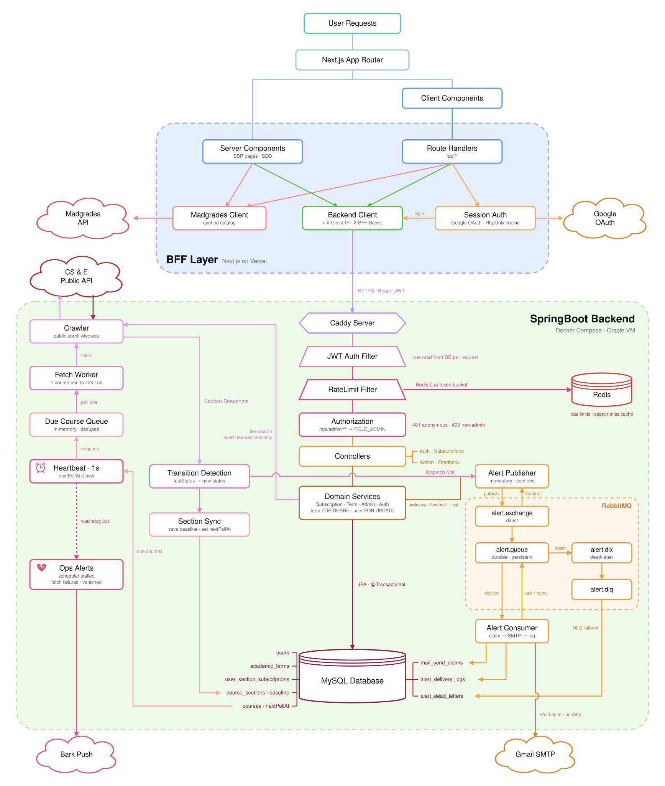

# MadEnroll

---

### A course seat monitor service for UW-Madison.

> [!NOTE]
>
> Website: [madenroll.com](https://madenroll.com)

### Project Structure：

### Tech Stack

Backend：
- Java 21
- SpringBoot 4
- MySQL
- RabbitMQ
- Redis
- Docker

Frontend：
- Next.js
- React 19
- TailwindCSS
- TypeScript

### How it works 

Subscribe courses after registering by email address. Users will receive email alerts when seats become available.

### Future

- Multi Crawler
- Reset Password
- Email Preference